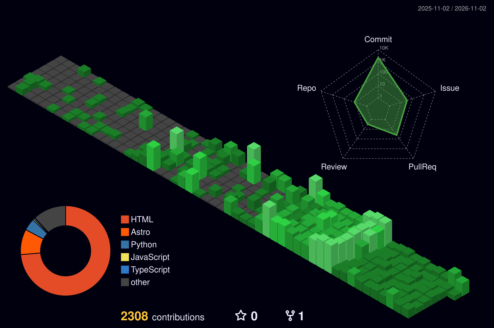

# [thdd](https://th-dd.top)

> Hello, thdd!

[🏠 Homepage](https://th-dd.top) · [💻 GitHub](https://github.com/th-dd)

## About me

- **Nickname**: thdd
- **邮箱**: [th-dd@foxmail.com](mailto:th-dd@foxmail.com)

---

---

